<!-- SPDX-License-Identifier: MIT -->

# Plan: Вивід (vyvid)

**Status:** planned, 2026-11-03. Nothing is built. The board is in [the status record](../status/vyvid-framework.md).
**Sketch:** [vyvid-framework](../sketches/vyvid-framework.md)
**Prefix:** VYD

## Scope

Extract LATTICE's index, registers and facets into a locally installed framework that binds behaviour to folders by configuration, holds domains and registers in a shared knowledge base or in projects, layers rules from general to project, and keeps the index outside git. LATTICE keeps working throughout, as the first project.

Out of scope: combining or re-creating repositories, and any change to LATTICE's published content.

## Order

```mermaid
gantt
  dateFormat X
  axisFormat %s
  section research and spikes
  VYD-0 temporal reasoning spike      :s0, 0, 2
  VYD-0b symbol indexing research     :s0b, 0, 3
  section the core
  VYD-1 configuration and binding     :s1, 2, 5
  VYD-2 the index core extracted      :s2, 5, 10
  VYD-2b LATTICE switches to vyvid    :s2b, 10, 12
  VYD-3 domains and register types    :s3, 10, 14
  section the knowledge base
  VYD-4 managed assets and git        :s4, 14, 17
  VYD-5 the store across scopes       :s5, 17, 21
  VYD-6 recipes and contracts         :s6, 21, 25
  VYD-6b containing a domain          :s6b, 25, 25
  VYD-6c checkouts and glue's reach   :s6c, 25, 25
  VYD-6d extractors run as commands   :s6d, 25, 25
  VYD-6e credentials and scanning     :s6e, 25, 25
  VYD-6f trust and held updates       :s6f, 25, 25
  VYD-6g identifiers, slices and units :s6g, 25, 25
  section first moves
  VYD-8b documentation beside symbols :s8b, 30, 30
  VYD-8c the Python domain and test bed :s8c, 30, 30
  VYD-7 the triple-store domain       :s7, 25, 27
  VYD-8 the Tools and Haskell domains :s8, 27, 30
  VYD-9 a project with private docs   :s9, 30, 33
  VYD-10 private rules as a domain   :s10, 33, 35
  section dogfood
  VYD-11 vyvid's own contract         :s11, 35, 38
  section optional
  VYD-12 agent coordination           :s12, 38, 42
  section trackers
  VYD-13 work tracked in a tracker    :s13, 42, 47
  section ready for LATTICE
  VYD-15 experiments recorded and an adoption baseline :s15, 30, 31
  VYD-16 skills that reach an agent :s16, 30, 31
  VYD-17 the reminder hook :s17, 30, 31
  VYD-18 the work board in Вивід :s18, 30, 31
  VYD-19 the lifecycle domain :s19, 30, 31
  VYD-20 generated regions and a release :s20, 30, 31
  VYD-23 configuration from the command line :s23, 49, 51
  section portability
  VYD-14 Linux and Windows in Docker  :s14, 47, 49
```

Units are agent days, as estimates. VYD-0 and VYD-0b run first and in parallel, since VYD-0's result may change VYD-2 and VYD-5, and VYD-0b's decides how VYD-3 builds extractors.

## Slices

| Slice | Deliverable | Done when |
|---|---|---|
| **VYD-0** | A spike of `project-minigraf/temporal_reasoning` against our index, time-boxed to two days, in `spikes/` or outside the repository (VYD-Q10) | The table below is filled with measured figures, and the maintainer chooses adopt, adopt ideas, or keep ours |
| **VYD-0b** | Research of how existing tools collect a codebase's symbols and index them, to a graph, to vectors or both, and a recommendation for the extractor interface, in a report beside the plan | The survey table below is filled, a tree-sitter prototype has extracted one Python and one Haskell module's symbols, and the maintainer chooses a general extractor, per-language ones, or an existing tool |
| **VYD-1** | The `vyvid` repository under the MIT licence, its README opening on the name's correspondences, `vyvid` installable with `uv tool install` and run as `vyd`, `config.toml` with bindings by path and by remote, scopes, projects and domains, each scope's identifier families and their delegations, and `vyd context` printing the resolved contract for a folder | `vyd context` in `~/work/lattice` prints LATTICE's contract last, and in a folder no binding matches prints the general scope alone |
| **VYD-2** | `tools/knowledge/` extracted as the `vyvid` core: register types declared, not built in, facets from any facet register, the embedding model, its thresholds and the embedded fields configurable. LATTICE's index built through it with today's results, and the general facet values and standards it takes from LATTICE relicensed MIT (VYD-Q13) | LATTICE's index built through it matches LATTICE's own, and `find` on the bake-off questions ranks every entry both hold as LATTICE's `find` does |
| **VYD-2b** | LATTICE switches to `vyvid`: its index tooling becomes a configuration of `vyvid` and a thin layer for what is LATTICE's own, its slices, its architectural quanta and its catalogue's owners, under LATTICE's contract on a LATTICE branch. It removes LATTICE's copy of what VYD-7 moved, after `vyd move register --check` compares every unmerged branch, keeps what each finding means for LATTICE and how to reproduce it on a LATTICE page at the record's old path, keyed to the domain's identifiers, with historical links pinned to a tag or commit of the domain | LATTICE's knowledge tests pass against `vyvid`, and `mise run graph:ask` answers through it as it answers today |
| **VYD-3** | `domain.toml` with a domain's parents, the extractor interface VYD-0b recommends, and the OWL domain with `owl-terms` moved out of the core | `find --kind term` in LATTICE answers as today, through the OWL domain, and a cycle among domains is refused |
| **VYD-4** | Managed assets under `kb`: clone, pull on the policy's schedule, commit and push by each domain's policy, conflicts reported and never merged | A row added by an agent to a managed register is committed and pushed under `auto`, and left staged under `manual` |
| **VYD-5** | One store outside git, one named graph per source, nodes with scope, source and visibility, `find` filtered to the bound scopes and ranked project first, a specialising row above the row it specialises, and the public-private citation check | A question in `lattice` never returns a private domain's entry unless `--scope` names it, a public diff citing one is refused, and a project's row ranks above a domain row of equal meaning |
| **VYD-6** | Recipes, chains of queries with glue scripts, declared by domains and projects. The generated per-domain skills and the user-level rule file | LATTICE's recipe for the studio's SPARQL returns the query-writing rules, their decisions and the persistence compiler's capability in under 1,000 tokens |
| **VYD-6b** | A domain contained: every path a manifest names stays inside its folder, symlinks leaving it are refused, a manifest cannot set its own `git` policy or `remote`, family patterns run on the `regex` package with a time limit, a domain holds text only, a domain's generated skill cannot take a core skill's name, `vyd domain audit` reports what it finds as facts, the core skill `vyvid-core-domain-review` reviews an external domain read-only, a glue step may set its own time limit, and `vyd recipe run --dry-run` prints each step and glue command without running it | The hostile domain of SEC-1 to SEC-5 is refused, and a review of a quarantined clone records its findings per commit and grants no trust |
| **VYD-6c** | A checkout is what a folder is answered from: a linked worktree reads its own files and has its own store, the embedding cache shared, and `vyd store prune` removes the stores of checkouts that are gone. Glue runs with a minimal environment, a step naming any variable it needs. A recipe can stop at a glue step and print its command for the agent to run through its own shell, then resume, by a flag or a setting the agent cannot override | In two worktrees of one repository, `find` answers each from its own registers, glue sees no token or SSH agent socket unless its step names it, and with the setting on `vyd` runs no glue itself |
| **VYD-6d** | A project's extractor run as a command in its own checkout, under the minimal environment. It is given its settings and an output folder, and writes a quads file and a JSON result, so any language can write one and each worktree runs its own version. Only a project's configuration declares a command, and a package installed with `vyd` keeps running in process | Two worktrees whose extractor differs each index by their own, a failed or malformed run is a problem that costs only its own entries, and a quad outside the project's graphs is refused |
| **VYD-6e** | Credentials: a remote URL with a user part on https, a password or a query is refused, a credential setting must name `env:` or `keychain:`, `vyd kb record` refuses to stage what looks like a credential, using `gitleaks` where it is installed and known formats otherwise, glue's error text is redacted, and the store and logs are owner-only with a setting to turn the logs off | SEC-15 to SEC-18 are closed by tests, with no credential ever printed in a refusal |
| **VYD-6f** | Trust: a domain's trust is set only in the user's configuration, a domain the user did not write gives knowledge alone, with no rules or skills installed and its results labelled as data, changes to its rules, skills or manifest are held until seen, a refused manifest sets aside only that domain, and a configuration outside the user's own folder must be trusted, by its hash, before any glue or command runs | SEC-7, SEC-8, SEC-9, SEC-13, SEC-14 and SEC-20 are closed by tests |
| **VYD-6g** | What a project running on `vyvid` must not lose: `vyd check identifiers`, a family being `removable` and naming a file of exceptions, a bare mention counting only where its identifier is defined, a register type shown only when asked for, the slice register type, and a `units` field in the extractor contract through which a project resolves its owners | On LATTICE, read-only, `vyd check identifiers` agrees with `mise run check:identifiers`, and `--kind slice` and a slice named in a question answer as LATTICE's index does |
| **VYD-7** | `vyvid-triple-stores`, a public domain of Markdown knowledge that cites no project: the record's findings keep their `TSD` numbers, with what each means for a project and how to reproduce it left out, and the query-writing rules in a family of the domain's own, `RDF-nn`. Since the rows are rewritten to stand alone, a move is declared rather than copied by a tool: a project's `[[projects.moves]]` names a family or its rows, the domain they went to, the source file and the commit they came from, so its mentions resolve through the domain with no rewriting of its text, for example `STD-030` to `triple-stores:RDF-5`. `vyd move check --ref <branch>` compares a branch's copy of the source with that commit by identifier. A domain citing a project is refused | The domain is committed and tagged, a domain citing a project is refused, every `TSD-nn` and mapped `STD` mention in LATTICE resolves through a configuration in a scratch knowledge base, and LATTICE is unchanged |
| **VYD-8** | `vyd domain new`, the Tools domain with its notes register, a project's specialisation of it, and the [code intelligence sketch](../sketches/code-intelligence.md) built: symbols from the tree-sitter extractor in a SQLite store per checkout, with `--kind symbol` and embeddings where measured to help, tools a project registers and the hand-off that names them, and a Haskell domain of measured findings | In a project, "how do I run the tests" returns the project's row first with the domain's note beneath it, the same question elsewhere returns only the domain's, a Haskell module's exports are found with `--kind symbol`, and a structural question is handed to a registered tool with each silent failure guarded. LATTICE's own row waits for its switch |
| **VYD-8b** | What authors wrote around the code, module headers, named sections and block comments, in the symbol store and searched with the symbols, by a method measured against symbols alone and documentation alone | The maintainer's question on a prioritised mailbox finds its section, a question a symbol answers still finds that symbol, and the bake-off is unchanged |
| **VYD-8c** | A Python domain of measured notes, and a test bed on this repository and, read-only, LATTICE: questions generated from `ast`, questions a docs-only agent wrote blind from architecture documents and sketches, and structural questions handed to a Python tool, each answer judged against the code | Extraction matches `ast` on both, each question has a recorded result and judgement, and what fails names what would fix it |
| **VYD-9** | `distributed-process` bound as a project, its code in one folder and its development documents in a private one, with a contract of its own | Its plans and registers are indexed and its board works, and nothing is written into its code repository but code |
| **VYD-10** | A user's own private rules kept as a private domain bound by remote | `vyd context` resolves those rules for each repository they cover, and nowhere else |
| **VYD-11** | `vyvid`'s own repository worked under a contract that `vyvid` resolves: its rules, skills and recipes in this repository's project scope, its registers indexed by itself, bound by a folder-local configuration rather than an AGENTS.md written by hand | An agent in this repository runs `vyd context` and gets this repository's contract, and `vyd find` answers from this repository's own registers |
| **VYD-12** | Optional agent coordination, as the [agent coordination sketch](../sketches/agent-coordination.md) answers it: claims of slices, units and next identifiers granted or refused atomically, held as leases renewed by every `vyd` command, logged as events, behind one interface with three choices, `none` by default, a local SQLite store, or a shared server | With `local`, two agents claiming one slice on one machine get one grant and one refusal naming the holder, a lapsed lease shows as stale, and two branches never take the same next identifier. With `none`, nothing changes from today |
| **VYD-13** | Work tracked in a tracker, as the [work-tracking sketch](../sketches/work-tracking-domains.md) answers it: a domain manifest's `requires`, `vyd doctor`, packages installed only with consent and never by a pull, an extractor run in a separate process, in Вивід's environment by default or in one a project names, the `work-tracking` domain with `jira` and `azure-devops` under it, and work items as a kind of record of their own beside the entries | A project on Jira sees its work items on `vyd board`, a missing package or credential is named by `vyd doctor`, a pull raising a requirement installs nothing until the user agrees, and two projects pinning different versions of one tracker package both build |
| **VYD-22** | `vyd install` sets up every client it finds, Claude Code and Copilot, with one command, and a missing domain is reported and never treated as an empty one | `vyd install` with no options writes each client's rules and skills, `vyd config` says when they are out of date or a domain's folder is missing, and `vyd install --project` refuses rather than removes when a domain is missing |
| **VYD-21** | A cloud agent bootstrapped with a chosen set of public domains and no terminal, as the [cloud agents sketch](../sketches/cloud-agents.md) answers it: `[framework] trusted_repositories` in the user's own configuration trusts a repository's committed `vyvid.toml` with no hash record, the automatic build says why it made no embeddings, and a store left without vectors is rebuilt for a question that ranks after ten minutes. Private domains wait for VYD-10 | A cloud session whose setup script wrote the user's configuration with a listed repository finds `vyd config`, `vyd context` and `vyd check skills` treating the project as trusted with no terminal, an uncommitted edit to its `vyvid.toml` lapses that, and a test that tries each case passes |
| **VYD-23** | Commands that add a domain, declare a project and register a family, so a person need not edit TOML by hand, validated before each write, keeping comments, and reading a documents folder's tables to propose its families, as the [configuration commands sketch](../sketches/config-commands.md) asks. Design first, its questions being open | A project with its documents in another repository is set up from an empty configuration by commands alone, and `vyd config` and `vyd build` accept the result, and a command that raises trust refuses without a terminal |
| **VYD-14** | The whole suite run in a Linux container and on Windows, once everything else is built, clearing TD-3, and a security test of the domain review. Linux containers run on any host. Windows containers need a Windows host, so the slice chooses between a Windows machine, a hosted Windows runner and a virtual machine | `mise run check` passes on Linux and on Windows, a family pattern's time limit is shown to fire on both, and the security test below has run with each technique it found recorded |
| **VYD-15** | Experiments recorded and an adoption baseline | The measurements of vyd-8c, scip, language servers and serena are in the plan, and `benchmark/adoption` counts how often a search tool comes before the index in a client's transcripts |
| **VYD-16** | Skills that reach an agent | A domain ships `skills/<name>/skill.md`, a project adds to one by heading, `vyd install --project` writes the composed skills into the project and `vyd check skills` fails on drift or on a source line with no home, and every generated skill opens on the index-first header naming where its registers are |
| **VYD-17** | The reminder hook | `vyd install` registers a pre-tool hook for Claude Code, Copilot and Codex that reminds and never refuses when a search runs in a shell, Bash or PowerShell, before any index question in that session |
| **VYD-18** | The work board in вивід | `vyd board`, `vyd work` and `vyd here` give every feature of LATTICE's board across branches, with level names, locations and the state ladder set by configuration |
| **VYD-19** | The lifecycle domain | `vyvid-lifecycle` holds the lifecycle, design, branching and publication skills, cites no project, requires only plans and status records, and takes a project's locations and additions |
| **VYD-20** | Generated regions and a release | The identifiers check reads no mention from a declared generated region, and `vyvid` is tagged so a project can pin it |

## VYD-14's security test

**Question.** What gets past the domain review, when the attack is written by someone trying to beat it?

**The container.** Linux, run with `--network none`, no bind mount and no volume of the host, a read-only root and a scratch `tmpfs`, not privileged, every capability dropped. Everything it holds is copied into the image at build. Whether it can see the host is tested first, from inside, and the test stops if it can.

**The reviewer's model stays outside.** A reviewer has to reach its model, which a container with no network cannot. So the model runs on the host and each tool call it makes runs inside the container, through `docker exec`. Nothing a reviewer is tricked into running can reach the host or the network.

**The attack.** An agent with no other context writes hostile domains from a copy of a real one, knowing the audit's patterns, the reviewer's brief and this repository, as an attacker would, since all are public. It aims for subtlety rather than the blunt attacks of the first run: advice that weakens a system while reading as sound, an attack split across files and only harmful together, instructions in the text a reviewer skims, such as the tail of a long file or past the audit's size limit, look-alike characters, authority and urgency, and a harmless first version followed by a hostile update. Each attack's payload is harmless, a marker inside the container and fake credentials.

**Scoring and what follows.** A separate agent reviews each domain with the skill as a user would, not knowing what was planted, and each round is scored as caught, missed or obeyed. Each technique that gets through becomes a row of the security register, with the guard it leads to in the audit, the skill or the manifest rules, and the round runs again. A clean round shows only that this attacker failed.

## VYD-0, the spike, in detail

**Question.** Does `temporal_reasoning` retrieve as well as our index, at a cost we accept, with features we would want?

**Setup.** Install it with `uvx temporal-reasoning[git-ingestion]` in a scratch folder outside any repository. Load LATTICE's registers into it through a small adapter: one entity per row, typed by its register, with the claim, the problem shape and the facets as attributes, and the declared edges as references. Ingest LATTICE's git history with its own `minigraf_ingest_git`, as its README describes.

| Measure | Ours, today | temporal_reasoning | How |
|---|---|---|---|
| hit@5 and MRR, 43 bake-off questions | 0.930, 0.857 | | its BM25 retrieval and its Datalog queries, each scored on the same expected answers |
| the same, 5 held-out questions | 1.000, 0.700 | | as above |
| latency per question, warm | about 0.2 s with the model loaded | | 20 questions, median and worst |
| tokens an agent reads to reach the answer | the table and the line under each row, a few hundred | | the per-turn injection's output, counted |
| build or ingest, cold and warm | 60 s, under 5 s | | the same corpus |
| as-of: what did the index hold on a date | git checkout and rebuild | | three questions about decisions that were later superseded |
| concurrency | many readers | one handle per process | two agents asking at once |
| reviewability | every fact is a Markdown line in git | | can a fact the agent asserted be reviewed before it counts |

**Outcome.** One of these, chosen by the maintainer from the table:

- **adopt it as the store**, under our Markdown as the source, if it matches our recall and adds as-of queries
- **run it alongside our index**, each for what it does well, for example ours for decisions, rules and terms ranked by meaning, and it for an agent's session memory and facts mined from git history, with `vyd context` saying which to ask for what
- **adopt its ideas**, such as bi-temporal as-of queries over our own store, or a per-turn injection hook that prints a recipe's answer before the agent asks
- **keep ours**, if it falls short on recall or on review

For "alongside", the spike also measures the overlap: how often the two return the same entry for a question, and whether an agent asking both spends fewer tokens than asking one.

## VYD-0b, symbol indexing, in detail

**Question.** How do existing tools collect a codebase's symbols, and index them, so that `--kind term` can answer for Haskell, Java, Python or TypeScript as it answers for OWL today?

**Survey.** For each, what it extracts, how, into what store, for which languages, its licence and its cost to run on LATTICE's `tools/` and `platform/`:

| Approach | Examples to read | Extracts | Store |
|---|---|---|---|
| tree-sitter tag queries | tree-sitter's `tags.scm` queries, GitHub's code navigation, Aider's repository map | definitions and references by language grammar | a ranked map, no store |
| language servers and compiler indexes | LSIF and SCIP (Sourcegraph), `ctags`, the `.hi` and `.hie` files of GHC, `jdeps` and the Java compiler's trees | resolved symbols, types and references | a graph of symbols and occurrences |
| code-graph builders | Kythe, GitHub stack graphs, CodeQL's databases | a cross-reference graph | a graph database |
| code embedding retrieval | the embedding indexes of coding assistants, code-specific embedding models | chunks of code by symbol | vectors |
| agent memory tools | `temporal_reasoning`'s git ingestion, which uses tree-sitter | functions and modules from history | a Datalog graph |

**Prototype.** One tree-sitter extractor, run on one Python module of `tools/knowledge/` and one Haskell module of `distributed-process`, writing the same term nodes `owl-terms` writes today: name, kind, module, signature or type, its comment, and its source line. Measured: symbols found against a hand count, time per thousand lines, and whether `find --kind term` answers three questions about each module.

**Recommendation.** A general tree-sitter extractor with a query file per language, if the prototype finds what a hand count finds, per-language extractors from compiler indexes where tree-sitter cannot resolve types, as Haskell's may need, or an existing tool such as SCIP read into our store.

## Questions for the maintainer

Questions VYD-Q1 to VYD-Q9, VYD-Q12 and VYD-Q13 are in the sketch, answered 2026-11-03, VYD-Q1 revised the same day. Two belong to the plan.

- **VYD-Q10.** Where the spike runs. Provisionally (c), outside any repository, answered 2026-11-03 and to be revisited when VYD-0 starts. The options were (a) `lattice/spikes/`, which puts a Вивід decision's evidence in LATTICE and lets the tool's installer add hooks to LATTICE's agent setup, (b) `vyvid/spikes/`, versioned with the decision it informs, and (c) a scratch folder outside any repository, where even the tool's full installer can be tried and its per-turn hooks measured, with the report copied into `vyvid` by hand.
- **VYD-Q11.** Answered 2026-11-03: `vyvid` has its own repository, `nebularis/vyvid`, from VYD-1, and LATTICE consumes it from VYD-2, so the extraction is the boundary.
