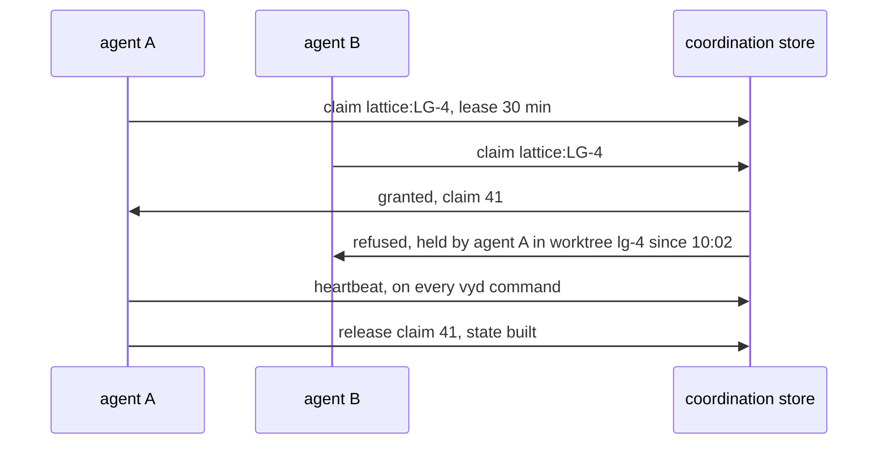

<!-- SPDX-License-Identifier: MIT -->

# Sketch: agents claim work through a store, not through branches

**Status:** sketch, 2026-11-03. Nothing is built or decided.
**Unit:** vyvid-framework
**Questions:** VYD-Q14 to VYD-Q19

## 1. What LATTICE does today

LATTICE's work board (`lattice:ADR-A151`) keeps a slice's state in its row on its unit's status board, inside the repository, so the state travels with the branch that builds it:

- **An agent marks before its first edit.** It sets the row to `building <day>`, regenerates the register, and commits that mark alone.
- **The board is read across branches.** `mise run work:board` reads every local and remote branch tip through one `git cat-file --batch` and joins the rows per slice.
- **Two branches building one slice are a double claim,** printed and never resolved by the tool.
- **Presence in a shared worktree** is a git-ignored file per session, live while touched in the last twelve hours.

It works, and it has four costs that follow from git being the medium:

| Cost | Why |
|---|---|
| A claim is invisible until it is pushed | the board reads branch tips, so two agents can each mark a slice before either push lands, and both start |
| A double claim is detected, never prevented | there is no atomic step in git that two agents both pass through |
| Every claim is a commit | the mark-alone commit before the first edit exists only so the board can see the claim |
| A crashed session's claim stays | a `building` row has no lease, so it reads as live until someone notices |

LATTICE also renumbers register rows when two branches take the same next identifier, which is the same race at a finer grain (`lattice:STD-276` to `STD-278` and `TD-93` collided in October 2026).

## 2. The proposal

Вивід keeps a **coordination store**, outside every repository, in which an agent claims work atomically before it starts and releases it when it hands off.

- **A claim** names a scope's work item, such as `lattice:LG-4` or a unit, the session that holds it, its worktree and branch, its host, and when it was taken.
- **It is granted or refused in one transaction,** so two agents can never both hold it. A refusal names the holder, which is what a person needs to decide whether to wait or take over.
- **A claim is a lease.** Every `vyd` command the session runs renews it. One not renewed within its lease is stale, and a stale claim is shown as stale and taken over only on request, never silently.
- **Every claim, renewal, release and takeover is appended to an event log,** so the history of who worked where is kept, and the live table is derived from it.
- **Identifiers can be allocated from the same store.** A family's next number, such as LATTICE's next `STD`, is taken in a transaction, so two branches never take the same one and nothing is renumbered at merge.

### What stays in the repository

The store holds what is live and short-lived. The repository holds what is durable and reviewed.

| Fact | Lives in | Why |
|---|---|---|
| who is building a slice now, and where | the store | it changes by the minute, is meaningless once the session ends, and two writers contend for it |
| a slice's state, `built`, `verified`, `merged`, with its day | the status board, as today | it is the reviewed record of the work, and travels with the branch that did it |
| the history of claims | the store's event log | audit, never reviewed line by line |

This follows the rule LATTICE keeps for its platform, that anything persisted outside the authoritative store is marked as coordination or derived (`lattice:PRI-52`). Claims are coordination. They cannot be rebuilt from the repository, and need not be, since a lost claim costs only a fresh one.

### Why not the index store

The index is derived. A build deletes it and writes it again, it is opened read-only by every question so that many agents can ask at once (`lattice:TSD-38`), and nothing in it may be a source. A claim written there would be lost on the next rebuild, and a writer would contend with every reader. The coordination store is a separate database with its own lifetime.

## 3. Options for the store

| Option | Atomic | Shared across machines | Cost to run | Fails how |
|---|---|---|---|---|
| **(a) SQLite** in the platform's data folder, one file per machine, transactions with `BEGIN IMMEDIATE` and a partial unique index on live claims | yes, across every process on the machine | no | nothing: a file, part of Python | agents on another machine, or in a cloud session, see nothing |
| **(b) a shared server,** PostgreSQL or a hosted key-value store with compare-and-set | yes | yes | a server to run, secure and reach, and credentials for every agent | the server is down, so no agent can claim |
| **(c) git, as today** | no | yes, through the remote | nothing new | the races of §1 |
| **(d) SQLite now, behind an interface a server can implement later, with the branch mark kept for work another machine must see** | yes on one machine | through the branch mark, as today | the interface, and a second code path | two code paths to keep honest |

**On one machine, (a) is all that is needed.** Every agent this repository has run so far ran on one laptop, in worktrees of one clone, and a SQLite transaction is atomic across them. A claim takes a few milliseconds, and a renewal is one indexed update.

**Across machines, a shared store is the only atomic option.** A cloud session, or a collaborator, cannot reach a SQLite file on someone else's laptop.

**Leaning (d).** SQLite now, because the races of §1 happen between agents on one machine. The interface would let a server back it when a second machine or a collaborator joins. The branch mark stays as the record another machine reads, so nothing that works today stops working. The cost is the interface, which is small: claim, renew, release, take over, list, and allocate.

## 4. What changes for an agent

| Today | With the store |
|---|---|
| set the row to `building <day>`, regenerate, commit the mark alone, push | `vyd claim lattice:LG-4`, which is granted or refused at once |
| read `work:board` to see who is building what, as of the last push | `vyd board` shows live claims from the store beside each branch's states |
| a double claim is printed after both have started | the second claim is refused before it starts |
| a crashed session's row reads `building` until someone edits it | its lease lapses, and it shows as stale |
| two branches take the same next `STD`, and one renumbers at merge | `vyd next lattice:STD` allocates it |

Whether the mark-alone commit is still needed depends on VYD-Q16. It is needed for as long as another machine must see the claim from the branch.

## 5. Questions for the maintainer

- **VYD-Q14.** Is the coordination store worth building now, or after the index core is done? Leaning after VYD-2, as a slice of its own, since it needs the configuration of VYD-1 and nothing of the index.
- **VYD-Q15.** Which store: (a), (b), (c) or (d) of §3. Leaning (d).
- **VYD-Q16.** Does the branch mark stay? Keep it as the record another machine reads, keep it only for work that spans machines, or drop it once every agent can reach a shared store. Leaning keep it until a shared store exists, and then drop the mark-alone commit but keep the states the board records.
- **VYD-Q17.** What may be claimed: a slice, a unit, a register's next identifier, a file. Leaning slices and units, and identifier allocation, since that is LATTICE's renumbering cost, and not files, which the branch already isolates.
- **VYD-Q18.** The lease and takeover. Leaning a 30-minute lease renewed by any `vyd` command, a stale claim shown and taken over only with `vyd claim --take-over`, which records who took it and from whom.
- **VYD-Q19.** How a session is named. Leaning the client's session id where it exposes one, as LATTICE's presence file uses, and otherwise one `vyd` generates and keeps in the worktree's git-ignored folder.

If the answers hold, this becomes a slice of the plan after VYD-2, with its own decision.
