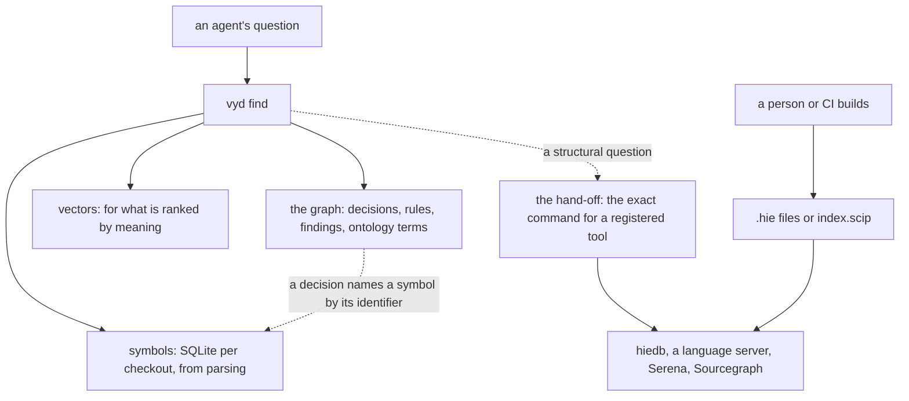

<!-- SPDX-License-Identifier: MIT -->

# Sketch: code intelligence, in stores of its own

**Status:** sketch, 2026-11-04, for the maintainer to settle. Nothing here is built.
**Unit:** vyvid-framework
**Questions:** VYD-Q28 to VYD-Q34

## 1. Two kinds of question

| | Meaning | Structure |
|---|---|---|
| Example | which function retries a failed write | what does this call in `distributed-process` |
| The answer is | ranked and fuzzy | exact, or wrong |
| It needs | names, signatures, docs, embeddings | resolved references, from a compiler |
| Who answers | Вивід | a tool the project has |

Вивід's own value is what neither kind offers alone, tying a decision to the symbols it governs. So it does not become a code intelligence engine, and it never builds anything, since a build runs a clone's code.

## 2. What we measured

The [research](../plans/symbol-indexing.md) covers extraction. This experiment asked its question of `distributed-process-client-server` and the packages under it, built in a scratch copy with GHC 9.10.3 and indexed with `hiedb` 0.8.0.0, 104 `.hie` files in all.

| Finding | Evidence |
|---|---|
| A compiler index answers the question exactly | `ManagedProcess.Server` references 12 names of `distributed-process`, leaving out instance dictionaries, each with its defining module and unit, and spot checks of each in the source were right |
| It sees through a facade | `getSelfPid`, `receiveWait` and `match` come through `Control.Distributed.Process`, and the index names `Internal.Primitives` |
| A dependency's `.hie` files are needed for less than expected | Without them we still get every name called, its module, its unit and each use. With them we also get where it is defined, a facade's exports, and its other callers |
| Hackage packages give no `.hie` files | none in the store. A rebuild with the flag gave some, and changed the package's unit id |
| Tree-sitter guesses from spelling | on this module it found 16 of the 18 names with 2 wrong, and could not choose among the 3 `sendChan` definitions or the 6 `Message` definitions |
| Building runs code | the chain holds a real `$(remotable ...)` splice, and the first build took 40 s |
| Indexing is cheap | 1.46 s for 104 files, and a query takes about 50 ms, nearly all of it process start |

**Where the data goes,** over 34,310 lines of Haskell in one repository:

| Store | Holds | Size | A search takes |
|---|---|---|---|
| Oxigraph | 3,415 symbols as quads | 5.2 to 6.3 MB | 3.79 ms by substring |
| Oxigraph | and 58,607 references | 39.7 MB | not measured |
| SQLite with FTS5 | 3,415 symbols | 1.29 MB | 0.013 ms by word |
| Vectors | 3,415 symbols | 5.25 MB | not measured here |
| `hiedb` | references, types, exports | 59.4 MB, about 40% of it types | about 50 ms |

References are what would explode in a graph, at 17 per symbol. Symbols in the graph would cost four times what SQLite does and search worse. The graph has no query a symbol needs. Thirty repositories like this one would be about 1.2 GB of quads against 39 MB of SQLite, by plain multiplication and not measured.

## 3. The proposal



- **The graph keeps knowledge.** Ontology terms stay, since they are knowledge and few. No code symbol enters it.
- **Symbols get a store of their own,** one SQLite file per checkout beside the graph store, from the tree-sitter extractor, with Python's own `sqlite3` and FTS5, so no new dependency beyond the grammars.
- **`find` joins them.** `--kind symbol` reads the symbol store, ranked by word and by the vectors of those symbols. Asked with no kind, `find` leaves symbols out, as it does terms, and may say that symbols match.
- **The join is an identifier,** `package:Module.name`, not a node. A decision's `Bears on` cell names a symbol and the graph holds that string. A check can report one that no longer exists. A package's name is used, without the hash a unit id carries, since the experiment saw that hash change.
- **A structural question is handed off.** A project registers the tools it has. Вивід never calls one, and tells the agent the exact command.

```toml
[[project.code_index]]
kind = "hiedb"
database = "code:.build/hie.db"
built_by = "mise run build:index"
sources = "code:packages/*/src"
```

Вивід may run nothing of this. It reads what the entry says, checks what it can without running anything, and prints the commands.

## 4. What a hand-off must guard

The experiment found that an agent can be misled in silence.

| Failure | What it looks like | Guard |
|---|---|---|
| `hiedb -D` on a wrong path | creates an empty database, prints nothing, exits 0 | check the file exists before naming it, and print SQL against `file:<path>?immutable=1`, since `hiedb` keeps its database in WAL mode, where a read-only open otherwise writes files beside it or fails |
| A misspelt name | an empty result, exit 0 | say that empty is not proof of no callers, and offer the symbol store's near matches |
| A stale index | still answers, and `hiedb index` skips with no warning | compare a source file's time with its `.hie`, or the source the `.hie` holds |
| No `-D` at all | writes a database into the home folder | every command is printed whole |
| Unbounded output | 27 KB for one facade's exports | every printed command has a limit |
| A tool not installed | exit 127 | check the `PATH`, and say how to get it |

## 5. Other languages

The shape holds. Only the row of `kind` differs: `hiedb` for Haskell, an `index.scip` read with the `scip` tool for Java, Rust, .NET, TypeScript and others, a language server through the client's own plugins or Serena, or Sourcegraph or Glean for a team. Each is built by a person or a pipeline, never by Вивід. Only Haskell was measured.

## 6. Questions for the maintainer

Answered 2026-11-04:

- **VYD-Q28.** The general tree-sitter extractor is the default.
- **VYD-Q29.** It ships as the extra `vyvid[symbols]`.
- **VYD-Q30.** Вивід tells the agent about a tool, and does not call it.
- **VYD-Q31.** Definitions are not imported from a compiler index for now.
- **VYD-Q32.** A project may name other projects it reads, for their knowledge. Exact questions across repositories belong to the compiler index.

Open:

- **VYD-Q33. Is the store as proposed?** Leaning yes: symbols in SQLite per checkout, with the graph holding only an identifier string.
- **VYD-Q34. Are symbols embedded?** It costs 5 MB and 30 s per repository like this one, by the model. Leaning yes for functions and types, with their docs, and not instances or fields, which crowded the top five in the research, and word search over all of them. To measure before settling.
