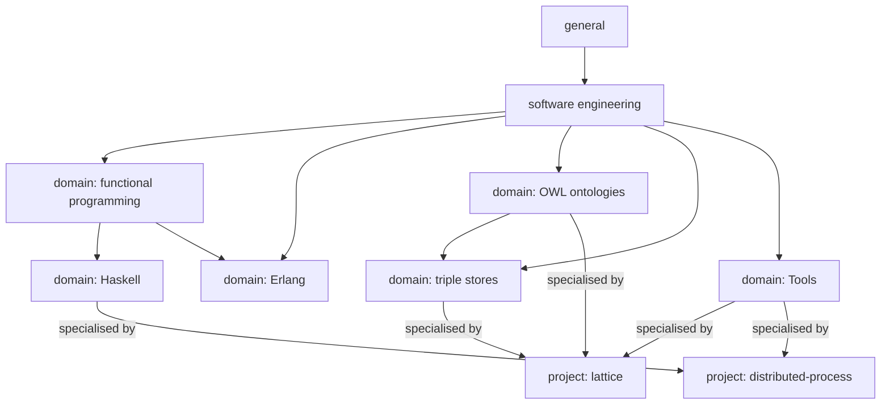
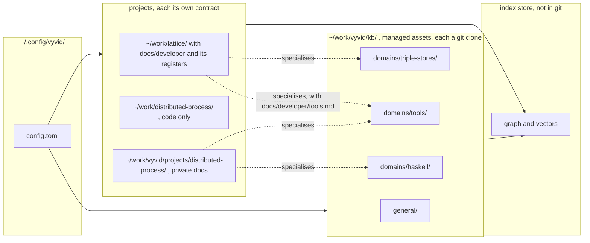
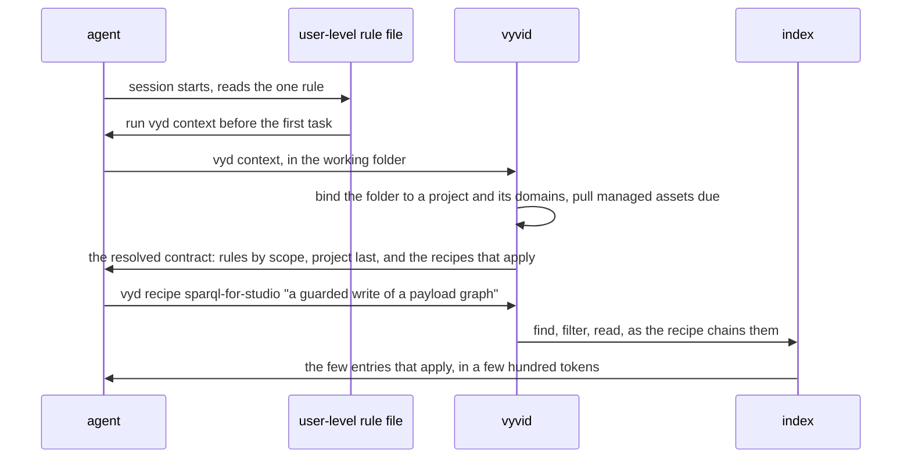

<!-- SPDX-License-Identifier: MIT -->

# Sketch: Вивід (vyvid), a local framework for agent knowledge and contracts

**Status:** sketch, 2026-11-03. Questions VYD-Q1 to VYD-Q9 and VYD-Q12 are answered, and nothing is built.
**Supersedes:** an earlier draft, kept in LATTICE's working notes, that proposed splitting LATTICE's repository. This sketch leaves the repositories alone.
**Plan:** [vyvid-framework](../plans/vyvid-framework.md)
**Question prefix:** VYD

## 1. What changes from the previous sketch

The repositories stay as they are. `lattice` keeps its contract, its registers and its index tooling, and nothing is combined or re-created. Instead the capabilities that are not specific to LATTICE are extracted into a toolchain installed on the machine, named Вивід, `vyvid`, with the command `vyd` (VYD-Q12). It works like the user-level overlay of rules that LATTICE's AGENTS.md allows (ADR-A117 in LATTICE), available to every agent and scoped by folder, with two differences:

- **The user says which behaviour applies to which folder,** in a configuration they edit, rather than the overlay deciding its own scope.
- **Knowledge is not tied to one repository.** Facets, registers and the skills that use them are grouped into domains, and a domain can live in a project, in a shared knowledge base, or in a repository of its own on GitHub, and can move between them.

What LATTICE has built stays the model: facets as SKOS schemes tagging across any number of dimensions, registers as Markdown tables whose header is their schema, a derived index ranked by meaning, and a contract that tells an agent to ask the index first.

## 2. The model



The domains form a directed graph, not a tree. A domain names its parents, so Haskell sits under functional programming and Erlang under both software engineering and functional programming, and a cycle is refused. A project specialises each domain it uses (§2.1).

| Construct | Is | Declares | Lives |
|---|---|---|---|
| **Facet scheme** | a closed set of values, SKOS, with broader and related values | its values, as a facet register | in any scope. A domain may extend a scheme of a wider scope with values of its own |
| **Register type** | the schema of a register: its columns, which are properties, its identifier family, what of a row is embedded, and its checks | columns, family prefix, embedded fields, limits | in the domain that defines it |
| **Register** | a Markdown table of one register type | rows | in a domain, or in a project as a target |
| **Domain** | a subject area: OWL ontology development, triple stores, Haskell, Java, Tools | its facet extensions, register types, registers, skills, query recipes and any extractor, such as the term summary for OWL | a folder with a `domain.toml`, in the knowledge base, in a project, or in its own repository |
| **Project** | a codebase and its contract | the domains it uses, where its code and its development documents live, its registers, its skills and recipes, its git policy | a folder bound in the configuration. Its development documents may live inside it, as LATTICE's do, or elsewhere |
| **Scope** | a layer of rules: general, software engineering, the domains along their graph, then the project | rules, skills and register rows, each with an identifier | the order is the configuration's and the domain graph's, most specific last |
| **Binding** | which project and which domains apply to a folder | a path, or a git remote, and what applies there | the user's configuration |

**A rule at a narrower scope overrides one at a wider scope.** A project's rule replaces a domain's of the same identifier, or states that it overrides another, and a domain's replaces a general one. Rules for efficient SPARQL are a domain's. That LATTICE generates the studio's SPARQL with the persistence compiler is LATTICE's. The same order holds for skills a project keeps in its own folder, such as LATTICE's `.claude/skills/`: a project skill overrides a domain's skill of the same subject, and the framework's generated skills never overwrite a project's.

### 2.1 A project specialises a domain

The Tools domain says how to use `mise`: tasks, environments, `mise exec`. LATTICE says more, for its own work: that every command goes through `mise run` or `mise exec`, that `check:knowledge` runs the index tests, that `build:knowledge` prints notes to read in full. An agent in `~/work/lattice` asking how to run the knowledge tests must get LATTICE's answer, with the domain's general one beneath it, and the same question in `~/work/distributed-process` must get the general one and whatever that project adds.

- **A project holds a register of the domain's register type**, in the project's own documents, for example LATTICE's `docs/developer/tools.md` of the Tools domain's note type, with the same columns and its own rows.
- **A row may name the domain row it specialises**, in a `Specialises` column, `ki:specialises`, and may state that it overrides it.
- **In a bound folder, `find` ranks the project's rows above the domain's at equal meaning**, and shows a domain row a project row specialises beneath it, as the linked table already shows a neighbour. A domain row the project overrides is shown only with `--scope` naming the domain.
- **Outside the project the project's rows are never returned**, since the binding does not admit the project's scope.
- **The same holds between domains**: the triple-stores domain may specialise the OWL domain's rows, and Haskell those of functional programming.

### Where things live



A dotted edge is a project specialising a domain: the project keeps a register of the domain's type in its own documents, and in its folder its rows rank above the domain's (§2.1).

- **Configuration** in `~/.config/vyvid/config.toml`.
- **Managed assets** under a configured base folder, `~/work/vyvid/kb`, each domain or group of domains a git clone of a repository the user may publish on GitHub, public or private.
- **Project assets** where the project keeps them. LATTICE's registers stay in `lattice` as targets. A project whose development documents must stay private, such as a contribution to `haskell-distributed/distributed-process`, has its code in one folder and its documents in another, which the configuration names.
- **The index** in a configured location outside git. The suggestion was `~/.config/vyvid/bin`. The conventional place for derived data is `~/.local/share/vyvid/` (XDG), and a cache that can be rebuilt is `~/.cache/vyvid/` (VYD-Q8).

## 3. A configuration, as an example

```toml
[framework]
kb = "~/work/vyvid/kb"
store = "~/.local/share/vyvid/index"

[embedding]
model = "BAAI/bge-small-en-v1.5"
revision = "5c38ec7c405ec4b44b94cc5a9bb96e735b38267a"
query_prefix = "Represent this sentence for searching relevant passages: "
weak = 0.69      # thresholds belong to a model, so they move with it
near = 0.74
facet_boost = 0.02

[scopes]
order = ["general", "software-engineering", "domain", "project"]

[[domains]]
name = "triple-stores"
path = "kb:domains/triple-stores"
remote = "git@github.com:nebularis/vyvid-triple-stores.git"
git = { pull = "on-start", commit = "auto", push = "auto" }

[[domains]]
name = "tools"
path = "kb:domains/tools"
remote = "git@github.com:<owner>/vyvid-tools.git"
git = { pull = "on-start", commit = "auto", push = "manual" }

[[domains]]
name = "haskell"
path = "kb:domains/haskell"
parents = ["functional-programming"]   # the domains form a directed graph

[[domains]]
name = "owl"
path = "kb:domains/owl"
extractors = ["owl-terms"]   # the term summary, today's --kind term

[[projects]]
name = "lattice"
code = "~/work/lattice"
match = { remote = "github.com/nebularis/lattice" }
docs = "code:docs"                  # development documents inside the repository
contract = "code:AGENTS.md"         # the project's own contract governs git on its targets
domains = ["owl", "triple-stores", "tools"]
registers = ["code:docs/developer/*.md"]
specialises = { tools = "code:docs/developer/tools.md" }   # how LATTICE uses mise, maven and its own tasks

[[projects]]
name = "distributed-process"
code = "~/work/distributed-process"
match = { remote = "github.com/haskell-distributed/distributed-process" }
docs = "~/work/vyvid/projects/distributed-process"   # private, never in the code repository
contract = "docs:CONTRACT.md"
domains = ["haskell", "tools"]
specialises = { haskell = "docs:haskell.md", tools = "docs:tools.md" }   # its cabal and stack conventions
git = { docs = { commit = "auto", push = "manual" } }
```

## 4. How an agent meets it

A user-level overlay works because one rule file tells every agent to read it. `vyvid` keeps that shape and makes the content dynamic.



- **One rule file** under `~/.claude/rules/`, and its equivalents for other clients, which `vyd install` writes. It says to run `vyd context`, and that the index is more current than the agent's memory of how to do a task.
- **Skills** are generated per domain into the client's skill folder, each naming the recipes for its work, such as writing Haskell, querying a graph database or authoring an ontology. A project's skills stay where the project keeps them, `.claude/skills/` for LATTICE, or its private documents folder for a project that keeps them out of its repository.
- **A recipe** is a project's or a domain's named chain of index queries, with an optional glue script between steps, declared in the domain or project manifest. It narrows the answer until it is specific to the work. For example LATTICE's recipe for the studio's SPARQL asks for the query-writing standards with `--tech sparql`, reads the decisions they name, and adds the persistence compiler's capability, which only LATTICE's scope holds.
- **An MCP server** exposing the same commands is a later step. It is the same tool behind a protocol, and it would let a client call `find` without a shell (VYD-Q3).

## 5. Git, by where an asset lives

| Asset | Who decides commit and push | Example |
|---|---|---|
| a managed domain or register under `kb` | that domain's `git` policy in the configuration: auto, or manual | a row added to the Tools domain's register is committed and pushed by the agent, or left staged, as the user chose |
| a project's target register, inside the project | the project's contract | a finding added to LATTICE's triple-store record is committed only with the maintainer's go-ahead, as LATTICE's AGENTS.md says |
| a project's private documents folder | the project's `git.docs` policy | `distributed-process`'s plans are committed automatically to a private repository, or not kept in git at all |

`vyvid` pulls a managed repository when its policy says, at a session's start or on a schedule, before it builds the index from it. A pull that conflicts is reported and never merged by the tool. It never pushes a project's assets, since the project's contract owns that.

## 6. Moving a register or a domain

The triple-store record is LATTICE's today, and its findings would serve any project that runs SPARQL on Oxigraph or Jena. Moving it:

1. `vyd move register store-discovery --to kb:domains/triple-stores` copies the record and its register type into the domain, with its history if the user wants it (`git filter-repo` on the one path).
2. The identifiers are kept, since `TSD-nn` is cited across LATTICE. The family prefix is registered globally, so no other register may take it (VYD-Q1).
3. `lattice`'s configuration gains the domain, so every `TSD-nn` mention still resolves, through the domain now.
4. LATTICE's copy is removed in a commit under LATTICE's contract, and its pointer documents say where the record went. A user-facing document that links the record directly is a public dependency on a domain, which VYD-Q6 asks about.

The reverse, promoting a project's knowledge into a domain, is the same move, and demoting is the move back.

## 7. Identifiers across many registers and projects

Today every family is LATTICE's, and `normalise()` makes `STD-12` one key. With many projects, two registers could each want `STD`.

| Option | A mention | Cost |
|---|---|---|
| (a) one global namespace of family prefixes, registered when a register type is declared | `STD-12` stays unique everywhere | a project cannot reuse a common prefix |
| (b) identifiers qualified by scope where ambiguous | `lattice:STD-12`, `haskell:STD-4` | every cross-scope mention is longer, and an unqualified one resolves within the current binding |
| (c) both: prefixes unique by default, a qualified form accepted | as (a), with (b) where a project insists | two forms to parse |

**Leaning (c).** LATTICE's families keep their prefixes, a new domain registers its own, and the qualified form exists for the case that needs it.

## 8. The index across scopes

- **One store, one named graph per source**, a domain or a project, rebuilt per source when its files change, so a pull of one domain re-embeds only that domain's changed text, as the digest cache already does.
- **Every node carries its scope, its source and its visibility**, public or private. `find` filters by default to the scopes the current folder binds, general, its domains and its project, and `--scope` widens or narrows it.
- **A check stops private text reaching a public project**: a diff in a public project that cites a private source's entry is refused.
- **The embedding model and the thresholds are configuration**, since WEAK and NEAR were measured for one model. A different model means a re-embed, which the vectors already record by revision.
- **What a register type embeds is its declaration**: today's name, claim, problem shape and Does not cover, or a domain's own choice, such as a Haskell finding's GHC version and extension set.

## 9. Domains by configuration

The OWL domain is first class today because the term summary, the `owl:` checks and the ontology skill are built into LATTICE's tools. Under `vyvid` it is a domain like any other, with an **extractor**, a plug-in that reads files of the domain's kind into nodes:

| Domain | Extractor | Registers | Skill names |
|---|---|---|---|
| OWL ontologies | `owl-terms`: classes, properties, concepts, individuals and their restrictions, as today | modelling patterns, mechanisms | the recipes for "does this term exist", "what restricts it" |
| triple stores | none | store findings, query rules | the recipes for "how does this store behave" |
| Haskell | a module's exports and types, by the extractor the symbol-indexing research recommends (the plan's VYD-0b), a general tree-sitter one or GHC's own `.hie` files | GHC findings, idioms, library notes | the recipes for "which library does this", "what GHC does here" |
| Tools | none | one register of notes per tool, `mise`, `maven`, `cabal` | the recipe "how do I do X with tool Y" |

A new domain is made by `vyd domain new tools --registers notes`, which writes its `domain.toml`, a facet extension stub and a register with the default note schema, and a skill stub that names its recipe. An AI skill, `vyvid-domain-design`, helps the user choose the register types and facets for a new subject.

## 10. What happens to LATTICE

LATTICE is the first project, and nothing in it has to move on day one.

| LATTICE today | Under `vyvid` |
|---|---|
| `tools/knowledge/` | becomes the core of `vyvid`, extracted with its tests. LATTICE then depends on it as a tool, or keeps a pinned copy until `vyvid` is installable (VYD-Q4) |
| the facet register | the general and software-engineering schemes move to `kb:general`, and LATTICE keeps the values only it uses as an extension |
| standards | split by scope. The query-writing rules, R1 to R8 and the H rules, go to the triple-stores domain, the writing rules to general, and what binds LATTICE alone stays |
| patterns | the RDF and IRI patterns go to the triple-stores and OWL domains |
| mechanisms, capabilities, principles, debt, pending decisions, backlog, questions, slices | stay in LATTICE, its own |
| the triple-store record | moves to the triple-stores domain when another project needs it (§6) |
| AGENTS.md and the skills | stay LATTICE's contract, now its project scope. Their general parts, asking the index first and reading the flags, move to the general scope and are no longer repeated in LATTICE |
| a user-level overlay of rules | becomes a domain bound by remote, kept private by its author, which is what it already is in all but name (VYD-Q7) |

## 11. The temporal reasoning spike

[`project-minigraf/temporal_reasoning`](https://github.com/project-minigraf/temporal_reasoning), MIT, read 2026-11-03: a memory layer for coding agents on the `minigraf` engine, a bi-temporal Datalog graph in one file with a SQLite FTS5 index for BM25 retrieval, driven through an MCP server or a Python library, with facts extracted by regex or optionally by an LLM, and no embeddings by design. Its README gives no latency or scale figures, only behavioural evaluations of the skill. 15 stars, no releases, one live database handle per process.

| | Our index | temporal_reasoning |
|---|---|---|
| source of truth | Markdown in git, reviewed, the index derived and disposable | the graph file, written by the agent |
| retrieval | embeddings ranked by meaning, facets, exact filters | Datalog, exact, and BM25 over text |
| history | git, and supersession edges | bi-temporal, as of a transaction or valid at a time |
| interface | a CLI, read-only store | MCP and a library |
| what it holds | the decisions, registers, questions and terms | an agent's session memory and facts mined from git history |
| concurrency | many readers, one rebuild | one handle per process |

**Hypotheses to test.** That BM25 matches or beats our embeddings on our 43 and 5 questions, which would remove a 130 MB model. That its bi-temporal queries answer "what did the index say when this was decided" better than git does. That its per-turn injection hooks lower the tokens an agent spends finding its context. That its write model, an agent asserting facts, fits a contract where the maintainer reviews every rule, which we doubt.

**Outcomes.** Adopt it as the store under our Markdown, run it alongside our index where it adds value, adopt some of its ideas, such as as-of queries or per-turn injection, or keep our own. The plan's spike says how each is measured.

## 12. Questions for the maintainer

Answered 2026-11-03:

- **VYD-Q1.** (c): family prefixes unique across scopes by default, and a qualified form `lattice:STD-12` accepted where a project needs it.
- **VYD-Q2.** The four scopes, with the domains a directed graph: a domain names its parents, any number of them, and a cycle is refused (§2).
- **VYD-Q3.** One rule file and `vyd context`, generated skills per domain, an MCP server later. A project's own skills, kept in its folder, take part in the same order and override above them.
- **VYD-Q4.** The tool is open source under the MIT licence. Each knowledge-base domain is a git repository of its own, public or private as its author chooses.
- **VYD-Q5.** A Scope column, read by the move tool.
- **VYD-Q6.** As leaned: a published document links only published decisions, so a move changes no published page, and working documents cite a domain entry by id.
- **VYD-Q7.** As leaned: a user-level overlay of rules becomes a private domain bound by remote, after the framework has run for a few weeks.
- **VYD-Q8.** The XDG locations, configurable, and resolved per platform: `~/.local/share` and `~/.cache` on Linux, `~/Library/Application Support` and `~/Library/Caches` on macOS, `%LOCALAPPDATA%` on Windows, through `platformdirs` rather than paths written in code.
- **VYD-Q9.** Python for now, with Rust a later phase's decision. The name is open, below.

Open:

- **VYD-Q12. The name.** Answered 2026-11-03: **Вивід**, written `vyvid` in the Latin alphabet by Ukraine's official transliteration, for the repository, the package and the documentation's Latin form, with the command **`vyd`**. All three were free on PyPI and as commands when checked that day. *Вивід* is the Ukrainian noun of *виведи* (derive it), and *логічний вивід* is logical inference. The README opens by setting out how the name corresponds to the five phrases it was drawn from. Every identifier in the code stays Latin.
