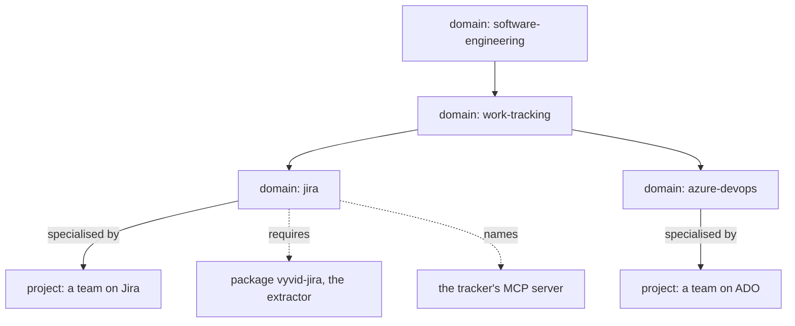

<!-- SPDX-License-Identifier: MIT -->

# Sketch: work tracked in Jira or Azure DevOps, through domains

**Status:** sketch, 2026-11-03. Its questions are answered, and it is built last, as slice VYD-13.
**Unit:** vyvid-framework
**Questions:** VYD-Q20 to VYD-Q27

## 1. The problem

LATTICE tracks work in its own repository. A slice's state is its row on its unit's status board, and the board is read across branches (`lattice:ADR-A151`). Most teams track work in a tracker instead, such as Jira or Azure DevOps (ADO), and a contract for such a team has to say two things LATTICE's never needed to:

- **where a slice's state is read from,** since the tracker holds it and the repository does not
- **how an agent changes it,** claiming an item, moving it along, commenting or linking a branch, since a tracker is changed through its API and not by a commit

The question this sketch answers is where the tooling for that lives: in each project's folder, or in domains that a project uses, which then need a way to install what they require.

## 2. The proposal

The generic tooling lives in domains, and only what is true of one project lives in its folder.



| Piece | Lives in | Holds |
|---|---|---|
| the model of tracked work | a `work-tracking` domain | a work-item register type, the ladder of states, rules such as "claim before you touch" and "a slice's state is the tracker's", and recipes such as "what is in progress on my branch" |
| a tracker's specifics | a domain under it, `jira` or `azure-devops` | how the tracker's fields and states map to the ladder by default, its rules, such as naming the issue in the branch and the commit, and its skills |
| reading work items into the index | an extractor plug-in, a Python package the tracker's domain requires | queries the tracker and writes work-item nodes into the project's scope, as the OWL domain's extractor writes terms |
| changing work items | the tracker's MCP server, which the domain names | agents create, move and comment on items through tools the client permissions, under the project's contract |
| how this team uses it | the project's configuration | the site, the project key, a reference to the credential, and the mapping from this team's states and custom fields to the ladder |
| what only this project does | the project's own folder | a glue script a recipe of its calls, and rules of its own that override the domains', such as "never move an item to Done" |

**Why not the project's folder alone.** Every project on Jira would write the same reader again. An extractor is installed code by the rule the domain slice set, run from an entry point and never from a file a clone happens to contain, so a script in a project folder cannot be one. The folder is the home for what is true of one project only.

**Why reads and writes are separated.** The index is derived and read-only to every question. Reading work items into it is a build step, run by the extractor. Changing an item is an action on someone else's system, which the project's contract governs and the client permissions tool by tool, so it goes through the tracker's own MCP server and not through Вивід.

## 3. A configuration, as an example

```toml
[[domains]]
name = "jira"
path = "kb:domains/jira"

[[projects]]
name = "payments"
code = "~/work/payments"
domains = ["jira"]

[projects.uses.jira.jira-items]
site = "https://example.atlassian.net"
project = "PAY"
credential = "keychain:vyvid/jira/example"
states = { "To Do" = "planned", "In Progress" = "building", "In Review" = "built", "Done" = "merged" }
fields = { "Story Points" = "estimate" }
```

A work item becomes a node of its own family, such as `payments:PAY-1234`, so a register row, a decision or a commit names it as it names any other entry.

## 4. Installing a domain that requires code

Adding a domain that requires a package installs code, which is where a supply chain is attacked. So a domain's manifest declares what it needs and runs nothing.

```toml
# kb:domains/jira/domain.toml
name = "jira"
parents = ["work-tracking"]
extractors = [{ kind = "jira-items" }]

[requires]
packages = ["vyvid-jira==0.3.1"]
mcp = [{ name = "atlassian", note = "for an agent to change items" }]
credentials = ["a Jira API token, referenced by the project's configuration"]
```

- **`vyd domain add <git url>`** clones the domain, shows every requirement, and installs the packages only when the user agrees, into Вивід's own tool environment.
- **`vyd doctor`** reports, for each bound project, every requirement missing: a package not installed or at another version, an MCP server not configured in the client, a credential that does not resolve.
- **A pull never installs.** A pull that raises a requirement, a new package or a new version, is reported and waits for the user, so an author's push cannot run new code on anyone's machine.
- **No script runs after a clone or a pull.** Setup is the declared requirements and nothing else, so what a domain can do on a machine is what its manifest says.
- **Credentials never live in a domain.** A configuration references one, by environment variable or keychain entry, and the extractor reads it through that reference.

## 5. What a tracker changes in the index

| Concern | What changes |
|---|---|
| freshness | A file's time cannot say a work item changed. The extractor asks the tracker for what changed since the last build, by its last-updated field, so a warm build reads only changed items, and an unreachable tracker leaves the last build in place with a problem saying so |
| rate limits | One query per build for what changed, paged, never one request per item |
| visibility | Work items are usually private, so their nodes carry private visibility, and the check that a public project's diff cites no private entry covers them |
| the board | `vyd board` shows a tracker's items beside a repository's boards, so a team with both, for example plans in the repository and tickets in Jira, sees one view |
| the ladder | A tracker's states map to the ladder, and a state the mapping does not name is reported, never guessed |

## 6. Claims in a tracker

Agent coordination (the agent coordination sketch) offers no store, a local store or a shared server. For a team on a tracker, a fourth backend suggests itself: a claim is an assignment and a move to the building state.

- **For.** The team already sees the tracker, so a claim there is visible to people as well as to agents, with no server to run.
- **Against.** Neither Jira nor Azure DevOps offers a compare-and-set on an assignment through its usual API, so two agents can both assign and both believe they hold the item. ADO's work item updates take a revision to test against, which may be enough. Jira's do not.

So a tracker can be a backend only where its API rejects a stale write, and that has to be probed on each tracker before the backend promises atomicity.

## 7. Questions for the maintainer

Answered 2026-11-03:

- **VYD-Q20.** As leaned: domains hold the generic tooling, and a project's folder holds only its own glue and rules.
- **VYD-Q21.** As leaned: an extractor reads, and changes go through the tracker's MCP server under the project's contract.
- **VYD-Q22.** As leaned: a manifest declares its requirements and runs no script.
- **VYD-Q23.** Packages install into Вивід's own tool environment **by default**, and a project may name an environment of its own, such as its `.venv` or the one mise gives it, in which its extractors run instead, as mise pins a Python or a Java per project. A project can then pin another version of a tracker's package, and two projects needing conflicting versions both work. It follows that an extractor runs in a separate process, given its settings and returning its quads, problems, findings and texts in a serialised form, which also isolates it from Вивід, and that the extractor package depends on Вивід's interface package wherever it is installed.
- **VYD-Q24.** As leaned: a pull that raises a requirement installs nothing until the user agrees.
- **VYD-Q25.** **Not as leaned.** A work item is a different kind of record, kept apart from the entries, never ranked by `find` among them, and read by the board and by recipes. How it is stored and cited is designed in its slice.
- **VYD-Q26.** As leaned: a tracker backs claims only where its API rejects a stale write, probed first, and only after the agent coordination slice.
- **VYD-Q27.** **As late as possible.** All of it, the manifest's `requires`, `vyd doctor`, consented installs, the held-back pull, the separate-process extractor, the work-tracking, Jira and Azure DevOps domains and the work-item record, is one slice, VYD-13, the plan's last. The managed-assets slice clones, pulls, commits and pushes, and installs nothing.
